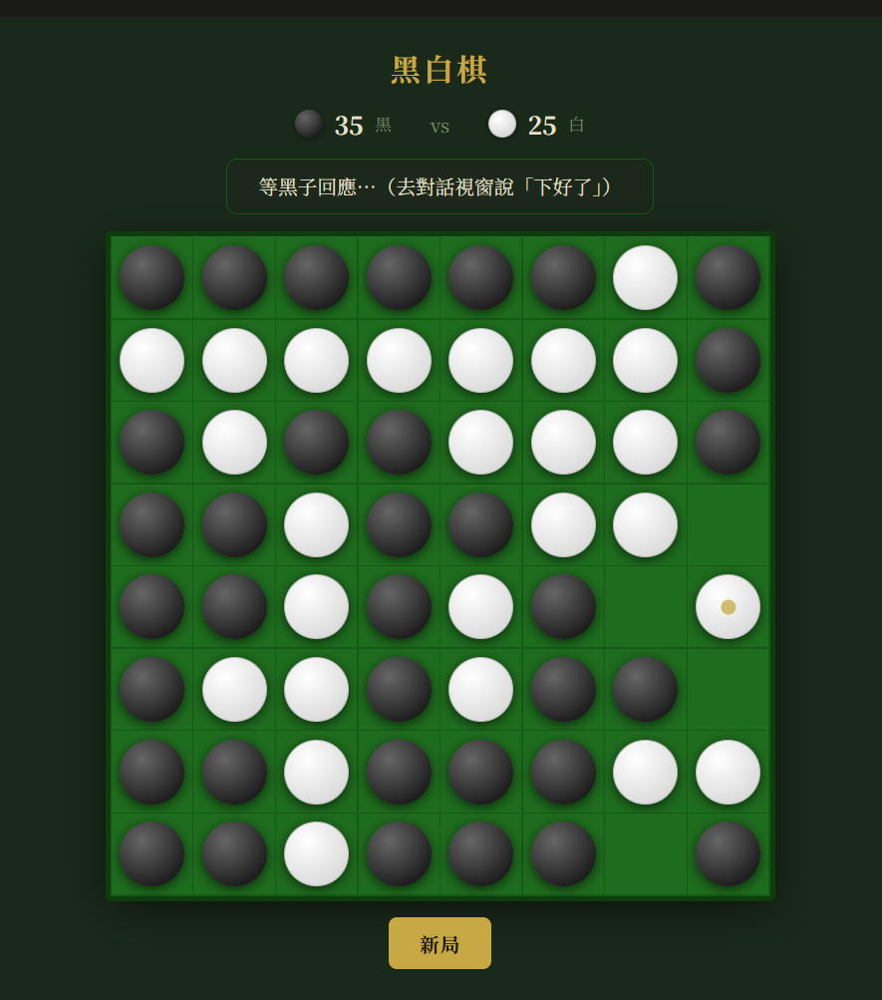
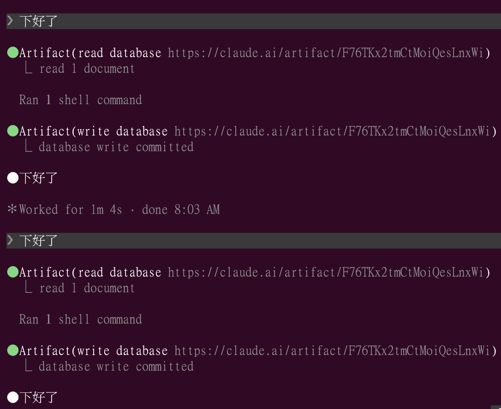

# claude-reversi

在 claude.ai Artifact 棋盤上，和你的 Claude Code AI 對弈黑白棋（翻轉棋）。

> ⚠️ **token 消耗提醒**：每回合需要 AI 掃描全盤計算合法落子，比一般任務消耗更多 token。  
> 建議在 **Max 訂閱方案**下使用；一般訂閱（Pro）玩幾局後可能明顯感受到額度消耗。

## 這是什麼？

利用 claude.ai Artifact 的共用資料庫，讓你和自己的 Claude Code AI 輪流對弈黑白棋：

- **棋盤**：運行在 claude.ai Artifact，有共用資料庫
- **你**：直接在棋盤上點擊落子
- **AI**：讀取資料庫、計算翻轉、寫回棋步
- **棋盤**：自動偵測更新，附翻棋動畫

## 快速開始

1. 複製 `artifact.html` 的內容
2. 在 claude.ai 建立新 Artifact——貼上內容並啟用 `db` 功能後發布
3. 開啟 Artifact，選擇你的棋子顏色
4. 將 Artifact URL 分享給你的 Claude Code session
5. 依照 `ai-guide.md` 讓 AI 扮演另一方
6. 落子後告訴 AI「下好了」，AI 會自動接手

## 功能

- 8×8 標準棋盤，DOM 渲染
- 翻棋動畫（scaleX flip，每顆依序延遲 55ms）
- 合法落子白點提示
- 投降按鈕（遊戲中途可隨時結束）
- 深色 / 淺色主題自適應

## 運作原理

```
你點擊棋盤落子
       ↓
棋盤寫入 db（turn → AI）
       ↓
你告訴 Claude Code AI：「下好了」
       ↓
AI 讀 db → 計算翻轉 → 寫回 db（turn → 你）
       ↓
棋盤偵測到更新 → 自動顯示翻棋動畫
       ↓
換你了
```

## 需求

- **claude.ai** 帳號（Pro 以上；建議 Max）
- Claude Code 在終端機或 IDE 中運行
- Artifact 在你自己的帳號下開啟

## 截圖

棋局終盤——黑子 35 : 白子 25：



Claude Code 操作畫面——AI 讀取棋盤、計算落子、寫回結果：



---

<details>
<summary>English</summary>

## What is this?

Play Reversi (Othello) against your own Claude Code AI, using a claude.ai Artifact as the shared game board.

- The **board** runs as a claude.ai Artifact with a shared database
- **You** click to place stones directly on the board
- **Your AI** reads the database, calculates flips, and writes its move back
- The board updates automatically with flip animations

## Quick Start

1. Copy the contents of `artifact.html`
2. In claude.ai, create a new Artifact — paste the contents and publish with `db` capability enabled
3. Open the Artifact and choose your stone color
4. Share the Artifact URL with your Claude Code session
5. Follow `ai-guide.md` to have your AI play the other color
6. After each move, tell the AI "下好了" — it will respond automatically

## Features

- 8×8 standard board, DOM-rendered
- Flip animations (scaleX flip, each stone delayed by 55ms)
- Legal move hints (translucent dots)
- Resign button (end the game at any time)
- Dark / light theme support

## Requirements

- A **claude.ai** account (Pro or above; **Max recommended**)
- Claude Code running in your terminal or IDE
- The Artifact must be opened under your own account

> ⚠️ **Token usage note**: Each AI turn requires a full board scan to find legal moves — significantly more expensive than typical tasks. Max plan is recommended.

</details>

---

By [CloverAI-Family](https://github.com/CloverAI-Family)
